

  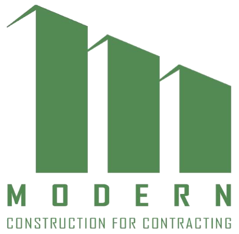

# Modern · Construction for Contracting

**From exploring the work to starting a project conversation.**

**Portfolio showcase.** Application source code remains private.
This public presentation includes selected website captures and project imagery.

A bilingual website for Modern Construction for Contracting, bringing the
company's services, project portfolio, and inquiry experience into one place.
Visitors can explore construction disciplines, look through project imagery,
and share the context the team needs to discuss their requirements.

[Explore Modern](https://www.moderngroupco.com/) ·
[Services](https://www.moderngroupco.com/our-services) ·
[Project portfolio](https://www.moderngroupco.com/projects) ·
[Start an inquiry](https://www.moderngroupco.com/contact-us)

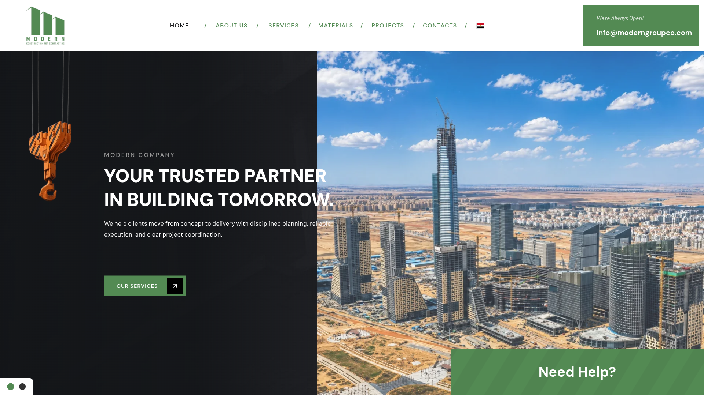

## 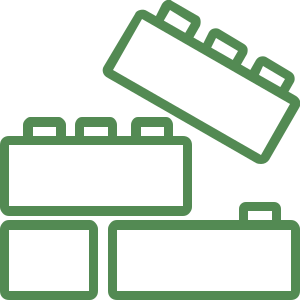 A clear introduction to the company

The home page introduces Modern through construction imagery, service previews,
selected work, and direct routes into an inquiry. A consistent green identity
connects the opening presentation with the rest of the site.

**English and Arabic. Light and dark themes. Responsive layouts.**
Language selection includes right-to-left presentation for Arabic visitors.

View the alternate construction hero

##  Find the right service

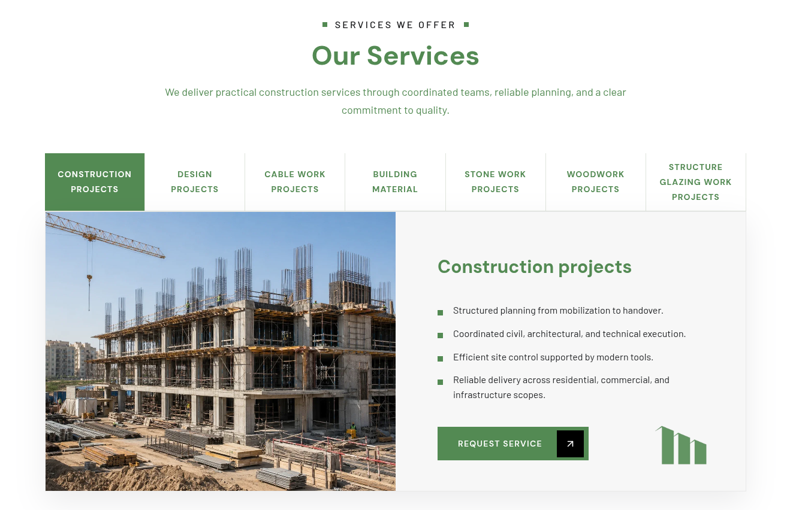

Seven service areas make the company's work easier to explore:

| Discipline | Focus |
| --- | --- |
| Construction | Building works and coordinated site delivery |
| Design | Concepts, drawings, and technical coordination |
| Cable work | Electrical and communication-system installation |
| Building materials | Material selection and sourcing inquiries |
| Stonework | Stone, marble, and architectural finishes |
| Woodwork | Joinery and interior wood applications |
| Structural glazing | Glass facades and glazing systems |

Visitors can move from a service into the contact form with the relevant
discipline already selected, keeping the inquiry connected to what they viewed.

## 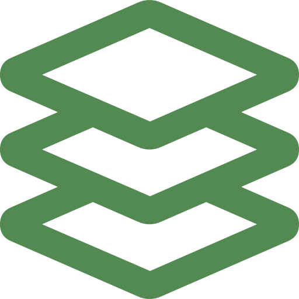 Explore the project portfolio

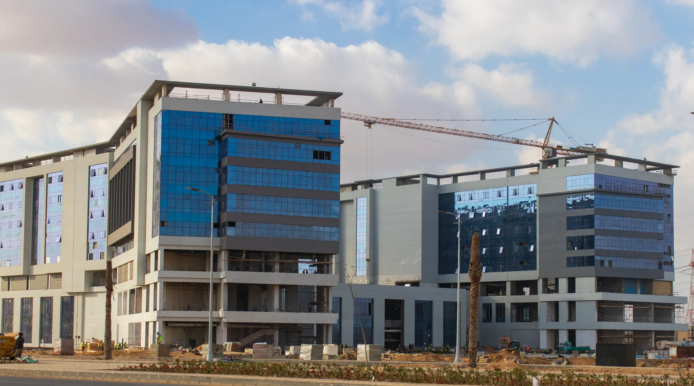

Category filters group the portfolio by discipline. Opening a project brings
its gallery, scope, and supporting details into focus, helping visitors move
from a broad service category to a specific example of the work.

The selections below come from the project's existing portfolio assets.
They include site photography, architectural drawings, and design imagery.

View construction and design selections

### Chinese Tower

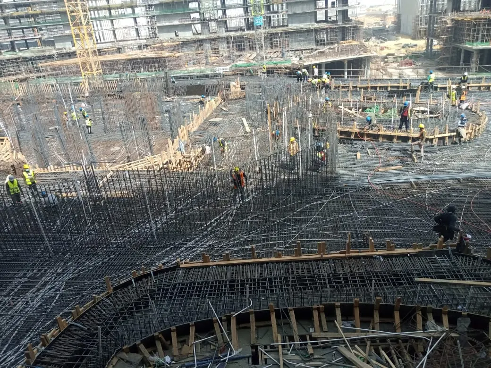

### King Abdulaziz Airport Training Center

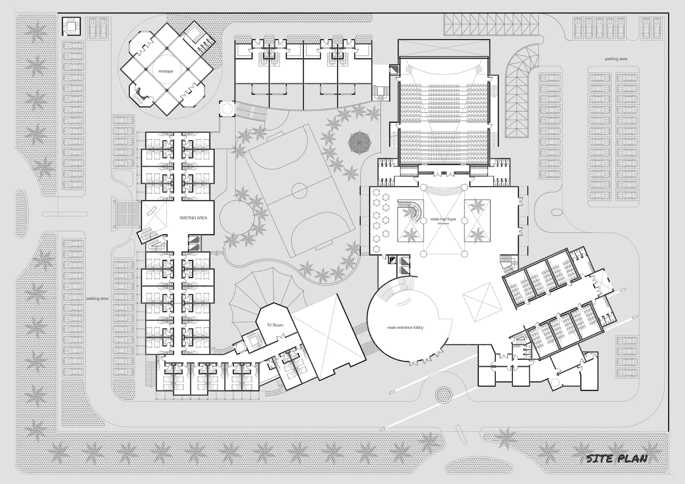

View glazing, stonework, and woodwork selections

### Glazing systems

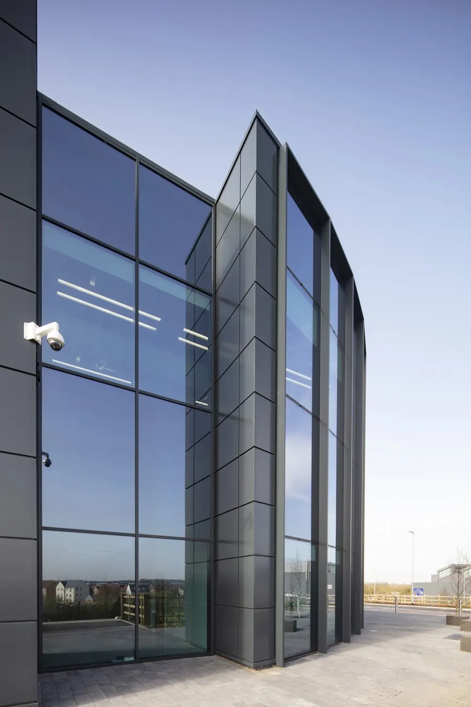

### Marble finishes

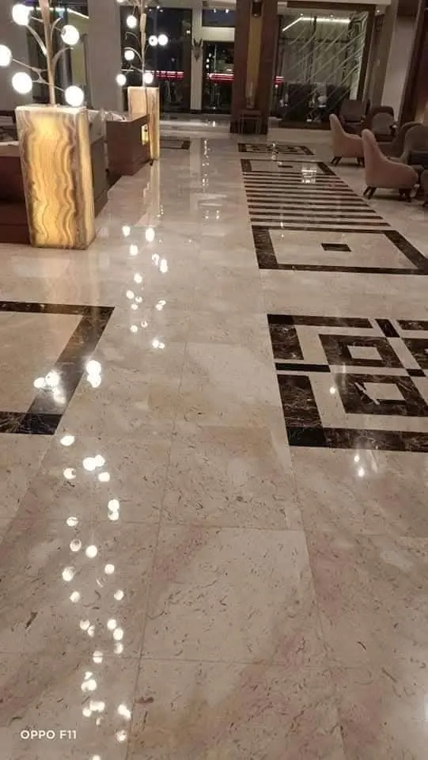

### Interior woodwork

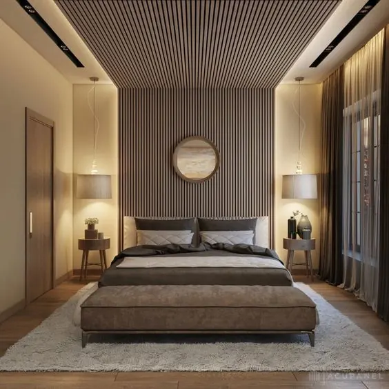

##  A materials desk in preparation

The supplied materials-page capture presents the catalog and request flow as
being prepared. Visitors are directed toward planning a materials request and
discussing their needs with the team. This is an inquiry journey rather than
an online checkout.

## 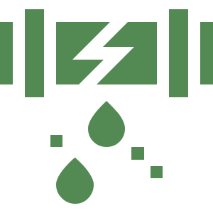 Give the conversation useful context

The contact experience collects the request type, relevant discipline, contact
details, project location, target timeline, and a written brief. Links from
services and projects carry context into the form so visitors can continue
their inquiry without starting over.

Submissions are validated on the server. Email delivery depends on the configured
email service; the form provides feedback when a request cannot be sent.

Modern AI provides an additional way to ask about services, projects, and how
to prepare an inquiry. Provider-backed responses depend on runtime configuration;
the app also includes a local fallback.

## Behind the experience

| Layer | Implementation |
| --- | --- |
| Application | React, TypeScript, and TanStack Start |
| Navigation | TanStack Router |
| Styling and motion | Tailwind CSS, Motion, and React Aria Components |
| Languages | i18next with English and Arabic resources |
| Runtime | Vite development and Cloudflare Workers configuration |
| Inquiry delivery | Server-side validation and Resend integration |

---

Website designed and developed by **[Abdulrahman M. Yaqyn](https://yaqyn.dev/)**.
Modern branding and portfolio imagery represent the client and its project material.

This showcase grants no software distribution license. Branding and portfolio
materials remain subject to their respective rights holders' permissions.
