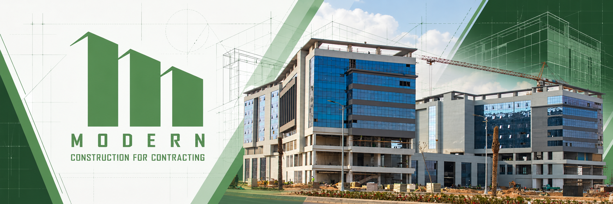
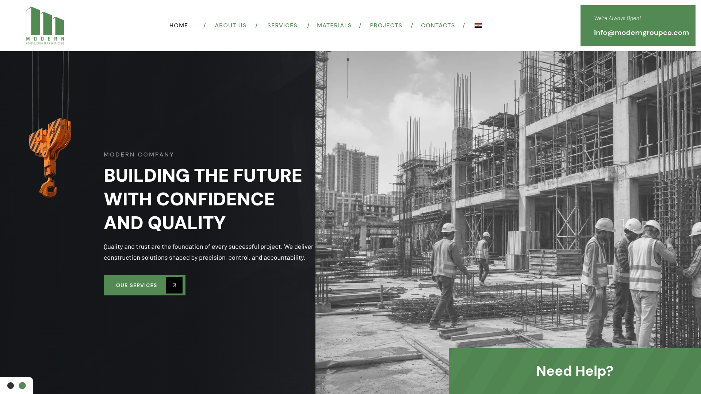
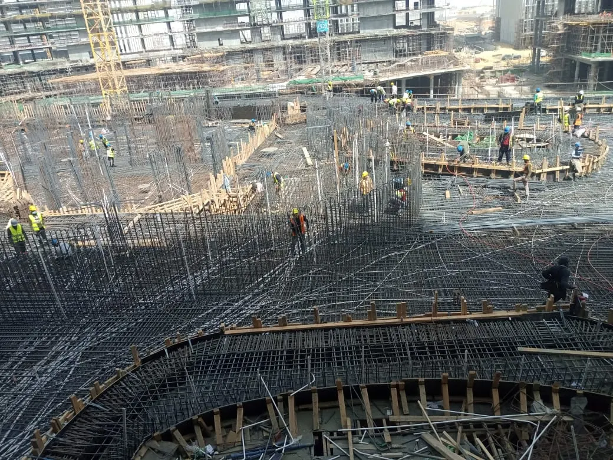
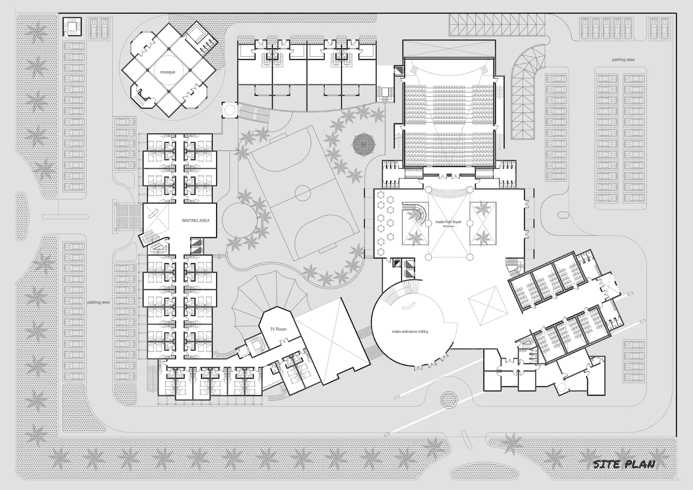
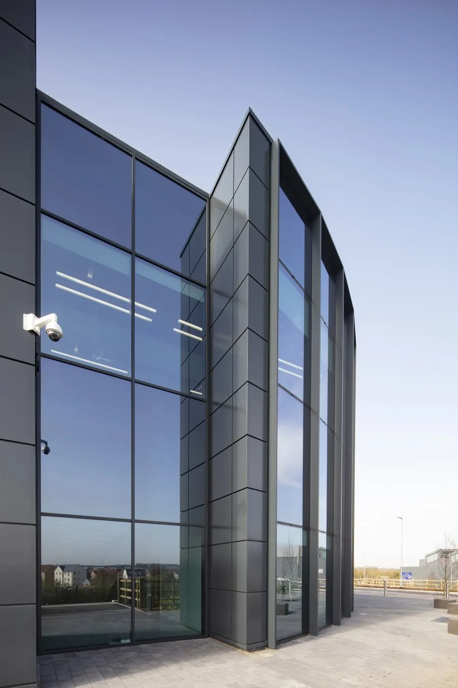
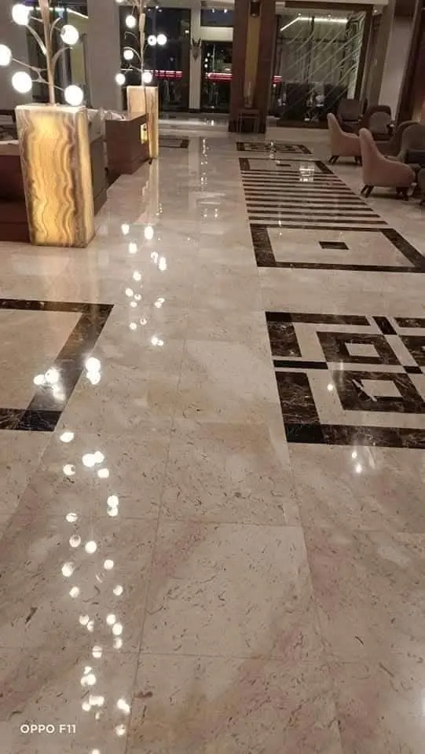
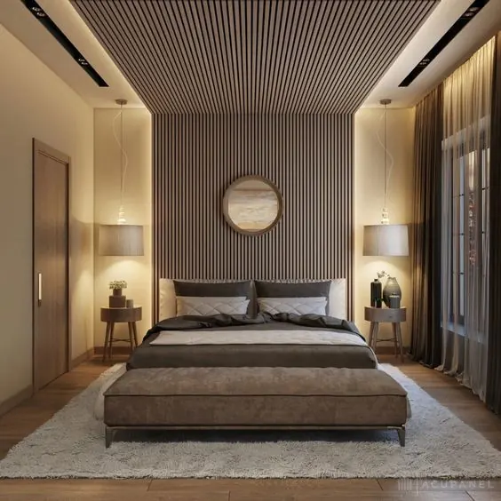
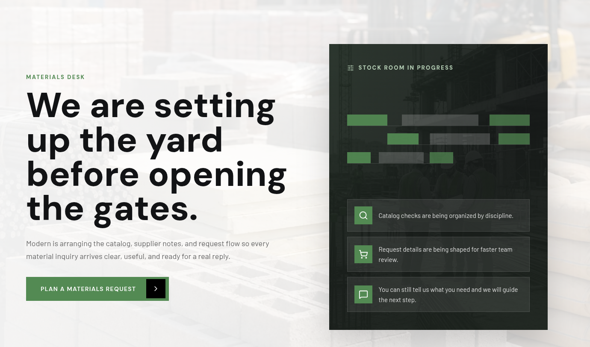
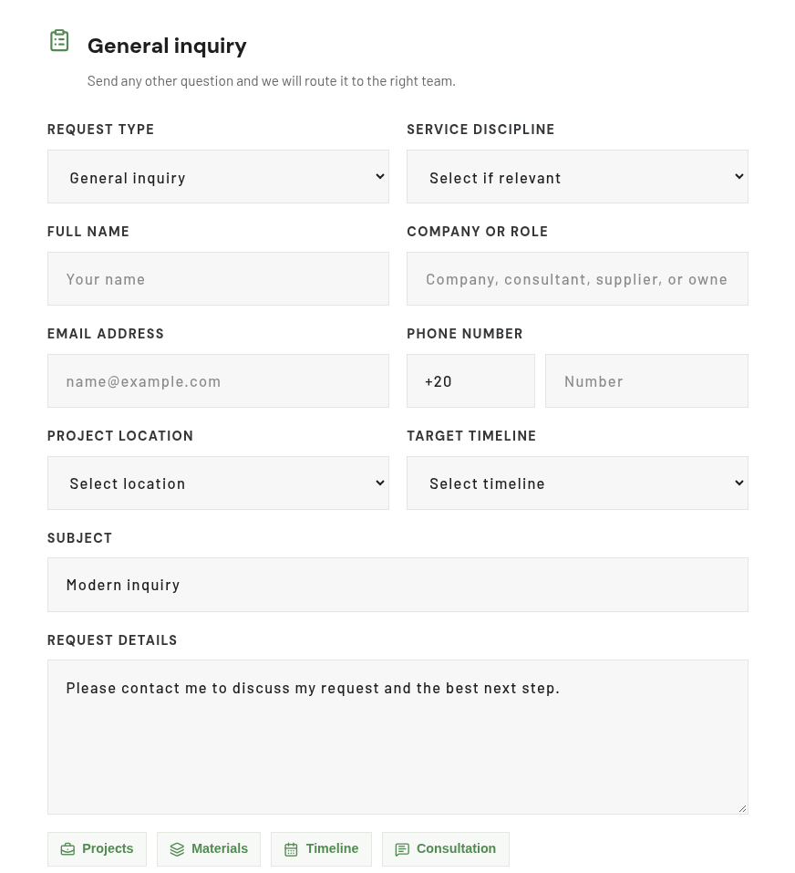

# Modern — Construction for Contracting

**Explore the work, find the right service, and start a project conversation.**

A bilingual website for Modern Construction for Contracting. Service pages,
project galleries, and context-aware inquiry links help visitors describe what
they need and give the team a useful starting point for the conversation.

**Public portfolio showcase.** Application source code remains private. This
presentation includes selected interface captures and existing project imagery.

[Explore Modern](https://www.moderngroupco.com/)

##  Features

- Explore seven service disciplines and continue into a relevant inquiry.
- Filter the project portfolio and open galleries, scope, and supporting details.
- Carry service or project context into a structured contact form.
- Browse in English or Arabic, with right-to-left layouts and light/dark themes.

##  Try the showcase

| Start here | What to look for |
| --- | --- |
| [Services](https://www.moderngroupco.com/our-services) | Select a discipline and follow its inquiry action. |
| [Projects](https://www.moderngroupco.com/projects) | Filter by discipline and open a project's gallery. |
| [Contact](https://www.moderngroupco.com/contact-us) | Review the request type, service, location, and timeline fields. |

A service inquiry should open the contact experience with the relevant context
selected. The contact form is a business inquiry channel; submit only genuine
requests. The materials-page capture below shows a preparation state, rather
than a completed online marketplace.

##  Usage

###  Company presentation

The home page introduces Modern through construction imagery, service previews,
selected work, and direct routes into an inquiry. The green identity connects
that opening presentation with the rest of the experience.

View the alternate construction hero

###  Find a service

| Discipline | Focus |
| --- | --- |
| Construction | Building works and coordinated site delivery |
| Design | Concepts, drawings, and technical coordination |
| Cable work | Electrical and communication-system installation |
| Building materials | Material selection and sourcing inquiries |
| Stonework | Stone, marble, and architectural finishes |
| Woodwork | Joinery and interior wood applications |
| Structural glazing | Glass facades and glazing systems |

Service links carry the selected discipline into the inquiry form, keeping the
request connected to what the visitor was exploring.

###  Explore project galleries

Category filters group the portfolio by discipline. Opening a project brings
its gallery, scope, and supporting details into focus. The selections below
come from existing portfolio assets and include photographs, an architectural
site plan, and interior-design imagery.

View construction and design selections

**Chinese Tower**

**King Abdulaziz Airport Training Center**

View glazing, stonework, and woodwork selections

**Glazing systems**

**Marble finishes**

**Interior woodwork**

###  Plan a materials request

The supplied capture presents the catalog and request flow as being prepared.
Visitors are directed toward planning a materials request and discussing their
needs with the team. This journey does not provide an online checkout.

###  Start an inquiry

The form collects the request type, relevant discipline, contact details,
project location, target timeline, and a written brief. Service and project
links carry context into the form so visitors can continue without starting over.

Server-side validation checks submissions. Email delivery depends on the
configured email service; the form provides feedback when a request cannot be
sent. Modern AI offers another route to service and project information, with
provider-backed responses dependent on runtime configuration and a local
fallback available in the application.

##  Architecture

TanStack Start connects the React interface to server functions for inquiries
and assistant requests. Language resources support English and Arabic, while
shared navigation helpers preserve the context of an inquiry across pages.

| Layer | Implementation |
| --- | --- |
| Application | React, TypeScript, and TanStack Start |
| Navigation | TanStack Router |
| Styling and interaction | Tailwind CSS, Motion, and React Aria Components |
| Languages | i18next with English and Arabic resources |
| Runtime | Vite development and Cloudflare Workers configuration |
| Inquiry delivery | Server-side validation and Resend integration |

##  Verification

Documentation checks validate local image references, private/public export
boundaries, brand-green icon geometry, and the publishing command's behavior
from another working directory. Raster conversions preserve dimensions and
decoded pixels; a staged secret scan precedes public publication.

##  Security and limitations

- Application source, private history, deployment workflows, and credentials
  stay in the private repository. The public repository holds presentation files.
- Screenshots show the supplied interface state; they do not verify current
  email delivery, AI-provider access, or completion of the materials marketplace.
- The cover is illustrative brand artwork. Portfolio captions distinguish site
  photography, drawings, and design imagery.

##  Maintainer

Website designed and developed by **[Abdulrahman M. Yaqyn](https://yaqyn.dev/)**.
Business inquiries belong in [Modern's contact form](https://www.moderngroupco.com/contact-us).

##  License and acknowledgments

This showcase grants no software distribution license. Modern's branding and
portfolio imagery represent the client and its project material and remain
subject to their respective rights holders' permissions.
